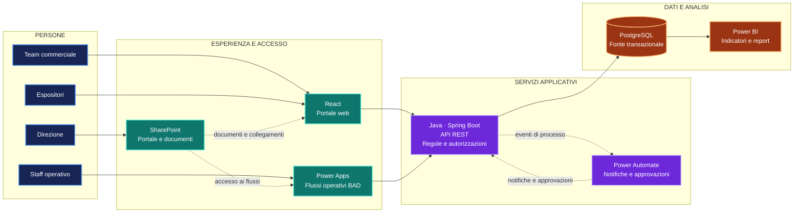
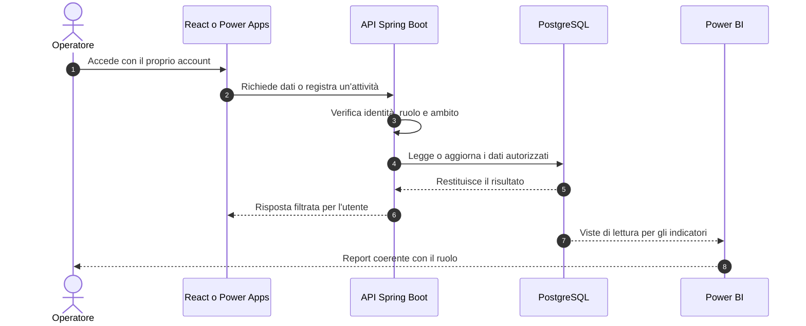
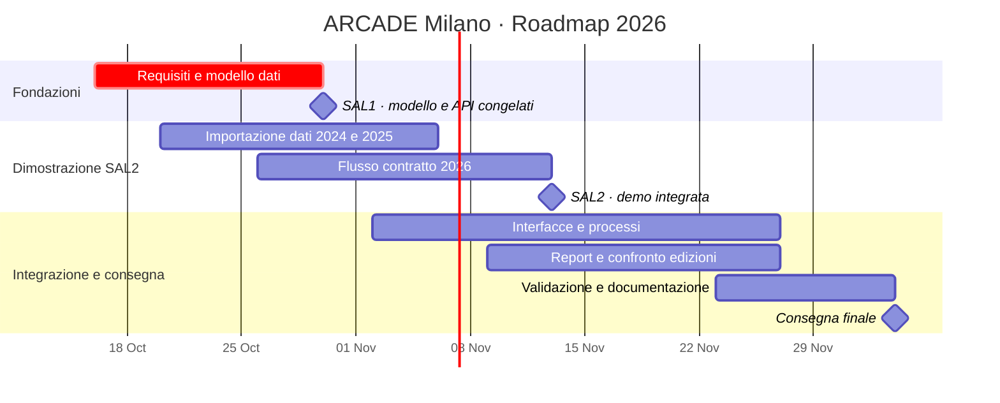

<div align="center">


Piattaforma integrata per coordinare espositori, vendite, operatività e risultati tra le edizioni dell’evento.

**Stand up** · Progetto Laboratorio Integrato "BID BAD" · 2026

[Panoramica](#panoramica) · [Architettura](#architettura) · [Stack](#stack) · [Roadmap](#roadmap) · [Gruppo](#gruppo) · [Metodo GitHub](#metodo)

</div>

---

## Indice

- [Il progetto in breve](#panoramica)
- [Architettura della piattaforma](#architettura)
- [Flusso operativo](#flusso-operativo)
- [Ruoli e visibilità](#ruoli-e-visibilita)
- [Stack tecnologico](#stack)
- [Indicatori da validare](#indicatori-da-validare)
- [Piano di consegna](#roadmap)
- [Gruppo Stand up](#gruppo)
- [Milestone](#milestone)
- [Metodo di lavoro su GitHub](#metodo)
- [Struttura prevista](#struttura-prevista)
- [Sicurezza e uso dei dati](#sicurezza-e-uso-dei-dati)
- [Stato del progetto](#stato-del-progetto)

---

<a id="panoramica"></a>
## Il progetto in spiccioli

ARCADE Milano è un festival di tre giorni dedicato al gaming e alla cultura pop. La piattaforma aiuta il team a preparare l’edizione, gestire espositori e sponsor, seguire le attività durante l’evento e misurare i risultati dopo la chiusura.

Il prototipo utilizza i dati delle edizioni 2024 e 2025 per supportare la pianificazione del 2026 e dimostrare un flusso operativo completo, dalla gestione commerciale alla reportistica.

| Prima dell’evento | Durante l’evento | Dopo l’evento |
| --- | --- | --- |
| Dati storici, offerte, stand e contratti | Presenze e visite agli stand | Risultati, confronto tra edizioni e rinnovi |

<a id="architettura"></a>
## Architettura della piattaforma



### Perché questa architettura

Il database PostgreSQL conserva i dati condivisi e mantiene relazioni coerenti tra edizioni, espositori, stand, contratti e presenze.

L’API Java con Spring Boot centralizza le regole applicative e i controlli di autorizzazione. React e Power Apps offrono interfacce adatte ai diversi processi, senza collegarsi direttamente alle tabelle.

SharePoint fornisce un punto d’accesso ai documenti e agli strumenti Microsoft 365. Power Automate gestisce notifiche e approvazioni; Power BI presenta gli indicatori per ruolo e ambito.

Questa separazione potrebbe rendere più semplice controllare gli accessi, evitare duplicazioni e modificare un componente senza riscrivere l’intero sistema.

## Flusso operativo



## Ruoli e visibilità

| Ruolo | Accesso previsto |
| --- | --- |
| Direzione | Indicatori aggregati, vendite e confronto tra edizioni |
| Commerciale | Espositori, sponsor, offerte, contratti e rinnovi |
| Staff operativo | Presenze e visite, secondo le autorizzazioni assegnate |
| Espositore | Dati e riepilogo della propria organizzazione |
| Amministratore | Configurazione, utenti e permessi |

I controlli vengono applicati dall’API. Nascondere una schermata nell’interfaccia non è sufficiente per proteggere un dato: ogni richiesta deve essere verificata anche lato server.

<a id="stack"></a>
## Stack tecnologico

| Componente | Tecnologia | Responsabilità |
| --- | --- | --- |
| Database | PostgreSQL | Persistenza relazionale e integrità dei dati |
| Backend | Java e Spring Boot | API REST, regole di business e autorizzazioni |
| Interfaccia web | React | Portale per operatori e area espositore |
| Portale documentale | SharePoint | Documenti, collegamenti e punto di accesso |
| App operative | Power Apps | Raccolta e gestione di processi BAD |
| Automazioni | Power Automate | Notifiche e approvazioni |
| Analisi | Power BI | Indicatori, riepiloghi e confronti |

## Indicatori da validare

Gli indicatori dipendono dalla disponibilità e dalla qualità dei dati. La prima proposta comprende:

- Espositori per edizione, categoria e stato del contratto.
- Offerte commerciali per valore e stato.
- Stand venduti e disponibilità residua.
- Presenze per giornata e fascia oraria.
- Visite agli stand, se raccolte con criteri verificabili.
- Confronto tra le edizioni 2024, 2025 e 2026.
- Riepilogo per espositore con accesso limitato alla propria organizzazione.

Per ogni indicatore saranno documentati definizione, fonte, formula, frequenza di aggiornamento e responsabile della validazione.

<a id="roadmap"></a>
## Piano di consegna



Le date rappresentano il piano di riferimento del corso. Il GitHub Project sarà la vista operativa per aggiornare stato, priorità, responsabile e scadenze.

<a id="gruppo"></a>
## Gruppo Stand up

Il gruppo è suddiviso in due aree di lavoro. Le issue saranno assegnate ai gruppi BID o BAD; i nominativi individuali verranno aggiunti quando tutti avranno aderito all’organizzazione.

### BID · Backend, database e integrazione

- Modello dati e migrazioni PostgreSQL.
- API Java con Spring Boot.
- Controllo di identità, ruoli e visibilità.
- Integrazione tra backend, frontend e strumenti Microsoft.

### BAD · Dati, processi e Business Intelligence

- Raccolta e validazione dei dati storici.
- Flussi Power Apps e Power Automate.
- Definizione degli indicatori.
- Report Power BI e confronto tra edizioni.

## Milestone

| Data | Risultato atteso |
| --- | --- |
| 30 ottobre 2026 · SAL1 | Modello dati e contratti API definiti e congelati |
| 13 novembre 2026 · SAL2 | Dati 2024 e 2025 importati e almeno un contratto 2026 dimostrato |
| 4 dicembre 2026 · Consegna | Prototipo integrato, documentazione e presentazione finale |

<a id="metodo"></a>
## Metodo di lavoro su GitHub

- Le **issue** descrivono funzionalità, attività, difetti e decisioni da validare.
- Le **sub-issue** suddividono il lavoro in attività più piccole e assegnabili.
- Il **GitHub Project** mostra stato, gruppo responsabile, priorità e scadenze.
- Le **pull request** descrivono le modifiche e consentono la revisione prima dell’integrazione.
- Ogni membro usa il proprio account GitHub.

Branch di lavoro:

- `main` per la versione integrata.
- `feature/nome-funzione` per una funzionalità.
- `fix/nome-correzione` per una correzione.
- `docs/nome-documento` per la documentazione.

## Struttura prevista

```text
.
├── backend/              # API Java e Spring Boot
├── database/             # Migrazioni PostgreSQL e dati dimostrativi
├── docs/                  # Architettura, modello dati, sicurezza e roadmap
├── frontend/              # Applicazione React
├── power-platform/        # Specifiche Power Apps, Power Automate e Power BI
└── README.md
```

## Sicurezza e uso dei dati

- Non inserire password, token, chiavi API o credenziali nel repository.
- Limitare i dati in base al ruolo e all’organizzazione dell’utente.
- Documentare fonti e trasformazioni dei dati importati.
- Raccogliere solo i dati personali necessari al prototipo.

## Stato del progetto

Repository inizializzato. Modello dati, API, indicatori, backlog e componenti applicativi saranno sviluppati per fasi...
