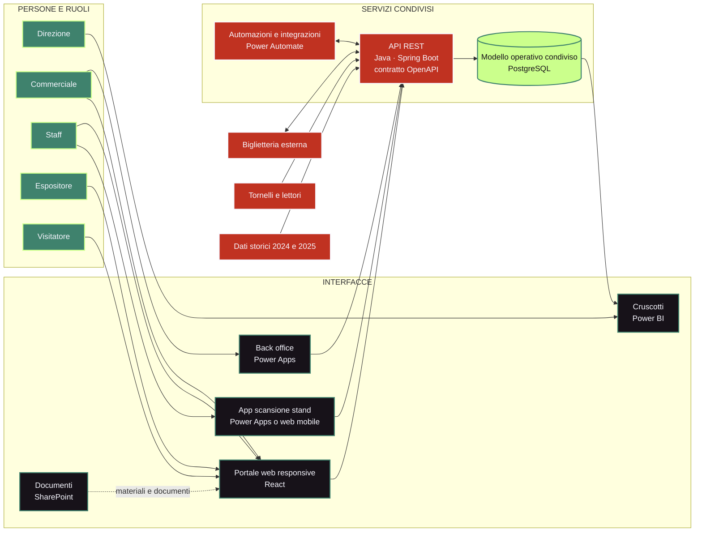
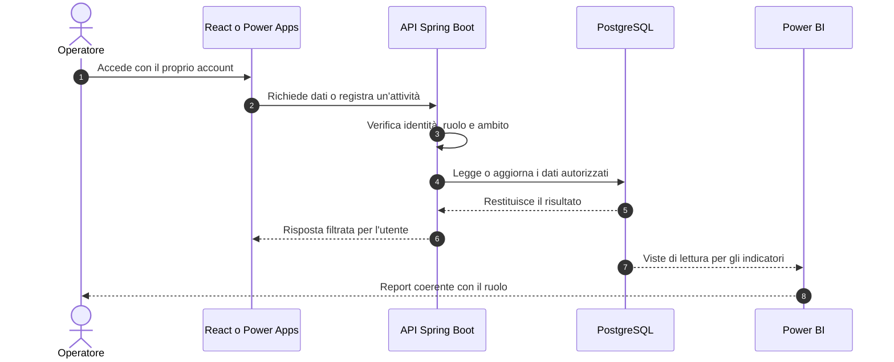
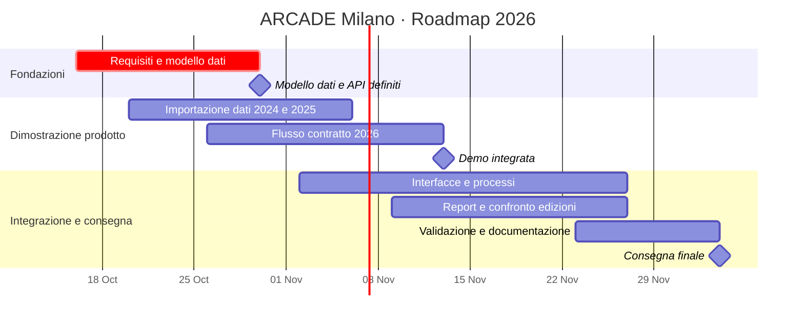

<div align="center">


Piattaforma integrata per coordinare espositori, vendite, operatività e risultati tra le edizioni dell’evento.

**Team Stand up** · ARCADE Milano · 2026

[Panoramica](#panoramica) · [Architettura](#architettura) · [Utenti](#ruoli-e-visibilita) · [KPI](#indicatori-da-validare) · [Roadmap](#roadmap) · [Gruppo](#gruppo) · [Metodo GitHub](#metodo) · [Identità visiva](#identita-visiva) · [Blueprint digitale](docs/blueprint-digitale.md)

</div>

---

## Indice

- [Il progetto in breve](#panoramica)
- [Architettura della piattaforma](#architettura)
- [Flusso operativo](#flusso-operativo)
- [Stack tecnologico](#stack)
- [React o Power Apps: chi usa cosa](#react-o-power-apps)
- [Ruoli e visibilità](#ruoli-e-visibilita)
- [Schermate da progettare](#schermate)
- [Modello dati iniziale](#modello-dati)
- [Indicatori da validare](#indicatori-da-validare)
- [Privacy e sicurezza](#sicurezza-e-uso-dei-dati)
- [Decisioni aperte](#decisioni-aperte)
- [Piano di consegna](#roadmap)
- [Gruppo Stand up](#gruppo)
- [Milestone](#milestone)
- [Metodo di lavoro su GitHub](#metodo)
- [Struttura prevista](#struttura-prevista)
- [Documentazione](#documentazione)
- [Identità visiva](#identita-visiva)
- [Stato del progetto](#stato-del-progetto)

---

<a id="panoramica"></a>
## Il progetto in breve

ARCADE Milano è un festival di tre giorni dedicato al gaming e alla cultura pop. La piattaforma aiuta il team a preparare l’edizione, gestire espositori e sponsor, seguire le attività durante l’evento e misurare i risultati dopo la chiusura.

Nasce da una bozza cartacea ed è pensata per fare bene tre cose:

1. **Vendere lo stand**, dal preventivo al contratto, con acconti e previsioni sotto controllo.
2. **Seguire l’affluenza**, cioè quante persone entrano, quando e dove, in diretta se i tornelli lo consentono.
3. **Confrontare le edizioni**, con un riepilogo dei numeri, il confronto con gli anni scorsi e la proposta di rinnovo agli espositori.

Le tre cose usano gli stessi dati, così direzione, commerciale ed espositori vedono numeri coerenti. La piattaforma valorizza i dati storici delle edizioni 2024 e 2025 e supporta la pianificazione di ARCADE Milano 2026.

| Prima dell’evento | Durante l’evento | Dopo l’evento |
| --- | --- | --- |
| Dati storici, offerte, stand e contratti | Accessi, presenze e scansioni agli stand | Risultati, confronto tra edizioni e rinnovi |

<a id="architettura"></a>
## Architettura della piattaforma



**Come leggere il diagramma.** Le persone usano l’interfaccia adatta al proprio compito. I client passano dall’API, che applica le autorizzazioni e legge o aggiorna il modello condiviso. I sistemi esterni e i dati storici entrano attraverso integrazioni controllate. Power BI consuma viste autorizzate. SharePoint è il punto per documenti e materiali.

### Perché questa architettura

Il database PostgreSQL conserva i dati condivisi e mantiene relazioni coerenti tra edizioni, espositori, stand, contratti, biglietti, accessi e scansioni.

L’API Java con Spring Boot centralizza le regole applicative e i controlli di autorizzazione. React e Power Apps offrono interfacce adatte ai diversi processi, senza collegarsi direttamente alle tabelle.

SharePoint è adatto a documenti e collaborazione, mentre le transazioni e le relazioni principali restano in PostgreSQL. Power Automate gestisce preventivi, approvazioni, contratti, notifiche e rinnovi. Power BI presenta gli indicatori per ruolo e ambito.

Questa separazione potrebbe rendere più semplice controllare gli accessi, evitare duplicazioni e modificare un componente senza riscrivere l’intero sistema.

### In parole semplici

| Livello | Che cos’è | Tecnologia |
| --- | --- | --- |
| Le schermate | Ciò che le persone vedono e toccano | React, Power Apps, Power BI |
| L’API | Il centralino: riceve le richieste, controlla chi sei e che cosa puoi fare, poi parla con l’archivio | Java, Spring Boot |
| L’archivio | Il database unico, dove vivono contratti, espositori, biglietti, accessi e scansioni | PostgreSQL |

<a id="flusso-operativo"></a>
## Flusso operativo



<a id="stack"></a>
## Stack tecnologico

| Componente | Tecnologia | Responsabilità |
| --- | --- | --- |
| Database | PostgreSQL | Fonte condivisa per contratti, espositori, biglietti, accessi, scansioni e personale |
| Backend | Java e Spring Boot | API REST, regole di business, validazione e autorizzazioni |
| Descrizione API | OpenAPI e Swagger UI | Contratto leggibile e documentazione degli endpoint, consultabili e provabili |
| Interfaccia web | React | Portale responsive per espositori, visitatori e operatività evento |
| App operative | Power Apps | Back office commerciale e, se la prova tecnica lo conferma, scansione allo stand |
| Automazioni | Power Automate | Preventivo, approvazione, contratto, notifiche e rinnovi |
| Documenti | SharePoint | File, planimetrie, contratti firmati e materiali |
| Analisi | Power BI | Indicatori direzionali e viste per ruolo |
| Identità | Microsoft Entra ID, da valutare | Accesso con account e gruppi, se disponibile per il contesto |

Le integrazioni con tornelli e scanner dipendono da hardware, protocolli, rete sul posto e API dei fornitori.

<a id="react-o-power-apps"></a>
## React o Power Apps: chi usa cosa

Power Apps e React non devono duplicare le stesse schermate. Per ogni flusso si sceglie il client più adatto, dopo una prova su autenticazione, uso da telefono o da computer, connettori e licenze.

| Flusso | Chi lo usa | Strumento | Perché |
| --- | --- | --- | --- |
| Area espositore | Espositore | React | Con il marchio, veloce, adatta al telefono |
| Biglietto e accesso | Visitatore | React | Semplice e leggibile da telefono |
| Operatività evento | Staff | React | Una sola navigazione, per ruolo |
| Back office commerciale | Commerciale | Power Apps | Si collega a Outlook e Word per i preventivi |
| Scansione allo stand | Staff | Da provare | Power Apps o web mobile, dopo la prova |
| Report direzionali | Direzione | Power BI | Indicatori e viste per ruolo |

**Regola.** Ciò che vede l’espositore o il visitatore va in React. Ciò che il commerciale usa dentro l’azienda per creare contratti va in Power Apps.

<a id="ruoli-e-visibilita"></a>
## Ruoli e visibilità

| Profilo | Che cosa deve poter fare | Limite di visibilità |
| --- | --- | --- |
| Direzione | Consultare KPI, vendite, affluenza e confronto tra edizioni | Dati aggregati, dettagli secondo incarico |
| Commerciale | Gestire contatti, offerte, contratti, acconti e rinnovi | Organizzazioni e pratiche assegnate |
| Staff | Consultare turno, area e stato operativo, registrare attività autorizzate | Dati necessari al servizio, senza accesso generalizzato ai dati commerciali |
| Espositore | Consultare la propria organizzazione, lo stand, il contratto e i servizi | Solo i propri dati e, se previsto, i lead del proprio stand |
| Visitatore | Consultare il proprio biglietto e le informazioni di accesso | Solo il proprio account e il proprio titolo d’ingresso |
| Amministratore | Configurare utenti, ruoli, edizioni e parametri | Accesso amministrativo tracciato e ristretto |

I controlli vengono applicati dall’API e anche nei dataset Power BI. Nascondere una schermata nell’interfaccia non è sufficiente per proteggere un dato: ogni richiesta deve essere verificata anche lato server. Per gli espositori serve un filtro per organizzazione che impedisca la consultazione dei dati dei concorrenti.

<a id="schermate"></a>
## Schermate da progettare

Il primo mockup usa un’unica navigazione, con pagine e azioni visibili in base al ruolo.

| Schermata | Utente principale | Contenuto |
| --- | --- | --- |
| Accesso | Tutti | Accesso, gestione sessione e messaggi di autorizzazione |
| Cruscotto direzionale | Direzione | Visitatori, picchi, saturazione, ricavi per m², costo per contatto e confronto edizioni |
| Operatività evento | Staff | Stato dei varchi, affluenza, avvisi, turni e riepilogo per area |
| Back office commerciale | Commerciale | Espositori, listino, planimetria, offerte, contratti, acconti e rinnovi |
| Area espositore | Espositore | Dati della propria azienda, stand, documenti, servizi e riepilogo autorizzato |
| Scansione allo stand | Staff o espositore autorizzato | Lettura QR, esito, orario e conteggio, con dati del visitatore solo se necessari e autorizzati |
| Biglietteria e accessi | Staff autorizzato | Verifica del biglietto, esito del varco, orario e gestione delle eccezioni |
| Report | Direzione e ruoli autorizzati | Filtri per edizione, giornata, area e fonte, con le definizioni dei KPI |

<a id="modello-dati"></a>
## Modello dati iniziale

Le entità sono una base di discussione tra BID e BAD. Relazioni e campi vanno definiti nel modello ER prima dell’implementazione.

- **Edizione**: anno, date, sede e stato.
- **Organizzazione / Espositore**: anagrafica, referente e stato.
- **Stand**: codice, area, superficie, disponibilità e assegnazione per edizione.
- **Offerta / Contratto / Pagamento**: importi, stato, date, acconti e rinnovi.
- **Biglietto**: codice, tipologia, validità ed edizione, evitando dati personali non necessari.
- **Accesso**: varco, esito, orario e riferimento al biglietto.
- **Scansione stand / Lead**: stand, orario, operatore e identificativo consentito.
- **Persona staff / Turno / Badge**: ruolo, area, orario e stato del badge.
- **Fonte importata / Esito importazione**: origine, data, righe elaborate e anomalie.

<a id="indicatori-da-validare"></a>
## Indicatori da validare

Gli indicatori dipendono dalla disponibilità e dalla qualità dei dati. Nessuna formula è ancora validata e va concordata con il committente.

| KPI | Definizione da concordare | Dati necessari |
| --- | --- | --- |
| Visitatori | Biglietti venduti, ingressi effettivi o persone uniche, che non sono la stessa misura | Biglietteria e letture dei varchi |
| Picco di presenza | Massimo di persone presenti nello stesso intervallo, da ingressi e uscite affidabili | Orari e direzione dei passaggi |
| Saturazione spazi | Occupazione: denominatore, area e soglia da definire | Planimetria, superficie e presenze |
| Visitatori per m² | Persone nell’area divise per superficie utile e intervallo | Presenze per area e m² |
| Ricavo per m² | Ricavo attribuito all’area diviso per superficie, con lordo o netto e periodo da chiarire | Contratti, incassi e planimetria |
| Contatti / lead | Scansioni valide e non duplicate, secondo consenso e regole concordate | Scanner, stand, orario |
| Costo per contatto | Costi inclusi divisi per lead validi, con deduplicazione da definire | Costi, campagne e lead |

Oltre a questi, la prima proposta comprende espositori per edizione e stato del contratto, offerte per valore e stato, stand venduti e disponibilità residua, il confronto tra le edizioni 2024, 2025 e 2026 e un riepilogo per espositore con accesso limitato alla propria organizzazione.

Per ogni indicatore saranno documentati proprietario, definizione, fonte, formula, frequenza di aggiornamento, filtri e controlli di riconciliazione, così il numero non cambia significato tra direzione, commerciale ed espositori.

<a id="sicurezza-e-uso-dei-dati"></a>
## Privacy e sicurezza

- Non inserire password, token, chiavi API o credenziali nel repository.
- Raccogliere solo i campi personali necessari e definire chi li può vedere.
- Limitare i dati in base al ruolo e all’organizzazione dell’utente, sul server e nei report.
- Stabilire tempi di conservazione, cancellazione e gestione delle richieste.
- Proteggere maggiormente i dati di eventuali minorenni.
- Non mostrare i dati personali dei visitatori durante la scansione se basta un esito o un conteggio.
- Registrare gli accessi ai dati sensibili e le operazioni amministrative.
- Documentare fonti e trasformazioni dei dati importati.

Gli appunti iniziali citano codice fiscale, età e curriculum per lo staff: prima del mockup va verificato se siano davvero indispensabili. Questi punti sono requisiti da validare con il responsabile privacy.

<a id="decisioni-aperte"></a>
## Decisioni aperte

Servono le risposte prima di scrivere codice.

1. Chi è il fornitore della biglietteria e che cosa identifica ogni biglietto?
2. I tornelli inviano eventi in tempo reale? Espongono ingressi e uscite o solo scansioni?
3. Lo scanner identifica una persona, un biglietto o un consenso alla condivisione del contatto?
4. Quali utenti sono visitatori registrati e quali usano un biglietto senza account?
5. Power Apps è adatto all’uso mobile offline e alla scansione sul posto? Quali licenze e connettori sono disponibili?
6. Come si definiscono capienza, saturazione, ricavo per m² e costo per contatto?
7. Quali acconti e previsioni entrano nei report e quali sono esclusi?
8. Quali dati storici 2024 e 2025 sono disponibili?

<a id="roadmap"></a>
## Piano di consegna



Le date rappresentano il piano di consegna condiviso. Il GitHub Project sarà la vista operativa per aggiornare stato, priorità, responsabile e scadenze.

### Sequenza di lavoro

1. Confermare processi e utenti con il cliente e con il gruppo.
2. Definire glossario, dati e permessi, comprese le regole privacy e i KPI.
3. Congelare il modello dati e il contratto API per il primo SAL, se le dipendenze sono disponibili.
4. Disegnare i mockup delle schermate per ruolo, con la palette ufficiale.
5. Provare le integrazioni con dati anonimizzati o dimostrativi e un singolo flusso completo.
6. Realizzare una prova completa: un espositore, uno stand, un contratto, un biglietto e un accesso tracciato, fino al report.
7. Ampliare i moduli, validare qualità e permessi, poi preparare demo e documentazione.

<a id="gruppo"></a>
## Gruppo Stand up

Il team è organizzato nelle aree BID e BAD, più alcune responsabilità trasversali. La ripartizione descrive i filoni di lavoro, non assegna ancora i singoli membri: le attività verranno concordate e aggiornate nel GitHub Project. Una persona può coprire più ruoli, ma le responsabilità restano esplicite anche quando sono accorpate.

### Membri del gruppo

1. Girelle Beni Benj
2. Giuseppe Sparviero
3. Giosuè Tedeschi
4. Mihai Blendea
5. Luca Cerrone
6. Vinicius Dematos
7. Marguerite Deido El Mbimbey

### BID · Dati e codice

- **Data Architect / DBA PostgreSQL**: modello dati condiviso, relazioni, vincoli, migrazioni e decisioni documentate.
- **Data Engineer**: importazione dei dati 2024 e 2025 da biglietteria, tornelli e scanner, con profilazione della qualità e registro delle anomalie.
- **Backend Developer**: contratto REST, endpoint, validazione e controlli di accesso con Java e Spring Boot.
- **Frontend Developer**: portale web responsive e cruscotto operativo in React.

### BAD · Power Platform

- **Power Apps Developer**: back office per listino, planimetria, contratti, acconti e previsioni, più una prova dell’app di scansione allo stand.
- **Power Automate / Integration Developer**: flusso dal preventivo al contratto, notifiche, rinnovi e passaggio dei dati commerciali nel modello condiviso.
- **Power BI / BI Analyst**: formule dei KPI concordate con il committente, report direzionali e coerenza tra le diverse viste.

### Responsabilità trasversali

- **Project Manager / Team Lead**: contatto con il committente, aggiornamento settimanale scritto, Gantt, rischi e decisioni.
- **Sicurezza e privacy**: controlli su API e Power BI, separazione dei dati degli espositori, protezione dei dati personali.
- **Git, documentazione e QA**: repository e README, contratto API, criteri di revisione, test tra i client e preparazione della demo.

<a id="milestone"></a>
## Milestone

| Data | Risultato atteso |
| --- | --- |
| 30 ottobre 2026 · SAL 1 | Modello dati e contratto API definiti, da confermare |
| 13 novembre 2026 | Dati 2024 e 2025 disponibili e un flusso di contratto 2026 dimostrato |
| 4 dicembre 2026 · Consegna | MVP integrato, documentazione e demo del prodotto |

<a id="metodo"></a>
## Metodo di lavoro su GitHub

- Le **issue** descrivono funzionalità, attività, difetti e decisioni da validare.
- Le **sub-issue** suddividono il lavoro in attività più piccole e assegnabili.
- Il **GitHub Project** mostra stato, gruppo responsabile, priorità e scadenze.
- Le **pull request** descrivono le modifiche e consentono la revisione prima dell’integrazione.
- Ogni membro usa il proprio account GitHub.

Branch di lavoro:

- `main` per la versione integrata.
- `feature/nome-funzione` per una funzionalità.
- `fix/nome-correzione` per una correzione.
- `docs/nome-documento` per la documentazione.

<a id="struttura-prevista"></a>
## Struttura prevista

```text
.
├── backend/              # API Java e Spring Boot
├── database/             # Migrazioni PostgreSQL e dati dimostrativi
├── docs/                 # Blueprint, architettura, modello dati, sicurezza e roadmap
├── frontend/             # Applicazione React
├── power-platform/       # Specifiche Power Apps, Power Automate e Power BI
└── README.md
```

<a id="documentazione"></a>
## Documentazione

- [Blueprint digitale](docs/blueprint-digitale.md): traduzione digitale della bozza cartacea, con architettura, processi, schermate, KPI, privacy e decisioni aperte. È la base di discussione con il gruppo e con il committente.

<a id="identita-visiva"></a>
## Identità visiva

La palette ufficiale di Stand up combina un fondo scuro con accenti luminosi e un colore secondario ispirato al palco e alla cultura arcade.

| Colore | Codice | Uso nel progetto |
| --- | --- | --- |
| Coffee Bean | #171219 | Fondo principale e testi su superfici chiare |
| Lime Cream | #cbff8c | Accenti, evidenze e stati attivi |
| Brick Ember | #c03221 | Azioni, dettagli di richiamo e contrasto |
| Ghost White | #f7f7ff | Testi su fondi scuri e superfici chiare |
| Jungle Teal | #3f826d | Elementi secondari, collegamenti e area dati |

I valori HEX sono i riferimenti ufficiali. Le tonalità derivate per gli stati intermedi possono essere usate nell’interfaccia, mantenendo leggibili testi e controlli.

<a id="stato-del-progetto"></a>
## Stato del progetto

Repository inizializzato. Il blueprint è la base comune da validare con il gruppo e con il committente. Modello dati, API, indicatori, backlog e componenti applicativi saranno sviluppati per fasi, a partire dalle decisioni aperte.
