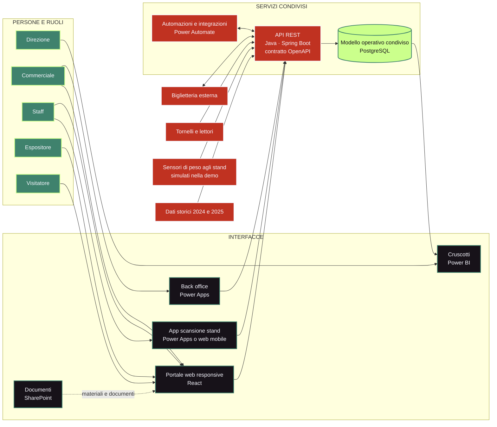
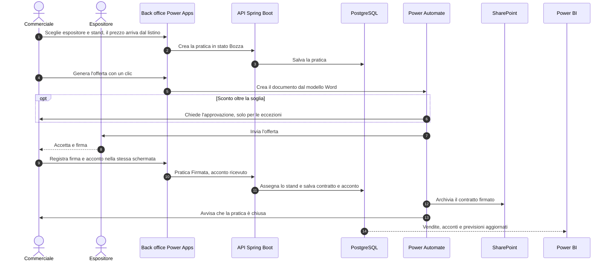
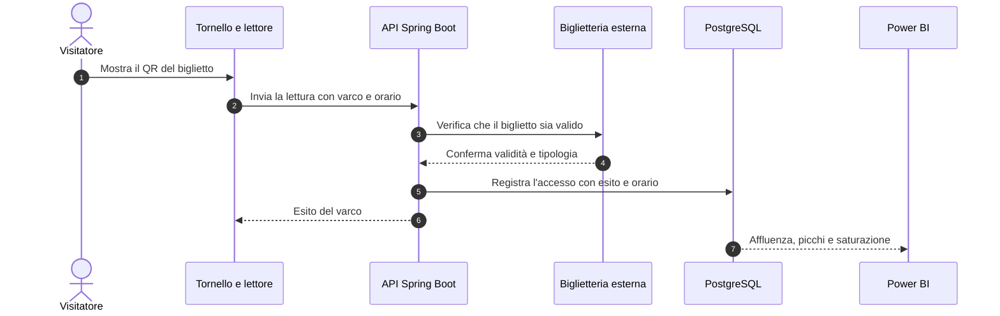
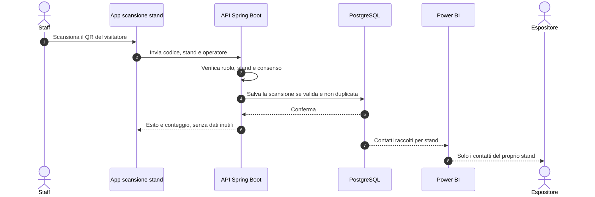
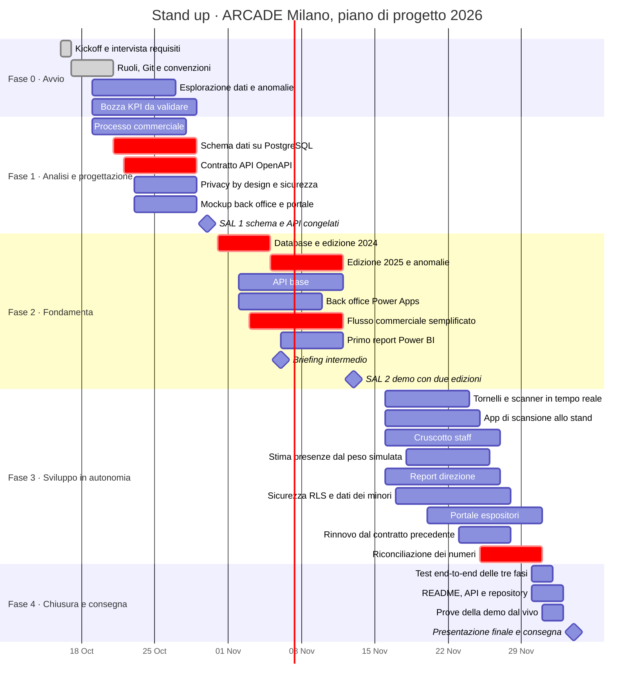

<div align="center">


Piattaforma integrata per coordinare espositori, vendite, operatività e risultati tra le edizioni dell’evento.

**Team Stand up** · ARCADE Milano · 2026

[Panoramica](#panoramica) · [Architettura](#architettura) · [Utenti](#ruoli-e-visibilita) · [KPI](#indicatori-da-validare) · [Roadmap](#roadmap) · [Gruppo](#gruppo) · [Metodo GitHub](#metodo) · [Identità visiva](#identita-visiva) · [Blueprint digitale](docs/blueprint-digitale.md) · [Frontend](docs/frontend-portale.md)

</div>

---

<a id="panoramica"></a>
## Il progetto in breve

ARCADE Milano è un festival di tre giorni dedicato al gaming e alla cultura pop. La piattaforma aiuta il team a preparare l’edizione, gestire espositori e sponsor, seguire le attività durante l’evento e misurare i risultati dopo la chiusura.

E' pensato per fare bene tre cose:

1. **Vendere lo stand**, dal preventivo al contratto, con acconti e previsioni sotto controllo.
2. **Seguire l’affluenza**, cioè quante persone entrano, quando e dove, in diretta se i tornelli lo consentono.
3. **Confrontare le edizioni**, con un riepilogo dei numeri, il confronto con gli anni scorsi e la proposta di rinnovo agli espositori.

Le tre cose usano gli stessi dati, così direzione, commerciale ed espositori vedono numeri coerenti.

| Prima dell’evento | Durante l’evento | Dopo l’evento |
| --- | --- | --- |
| Dati storici, offerte, stand e contratti | Accessi, presenze e scansioni agli stand | Risultati, confronto tra edizioni e rinnovi |

<a id="architettura"></a>
## Architettura della piattaforma



### Perché questa architettura

Il database PostgreSQL conserva i dati condivisi e mantiene relazioni coerenti tra edizioni, espositori, stand, contratti, biglietti, accessi e scansioni.

L’API Java con Spring Boot centralizza le regole applicative e i controlli di autorizzazione. React e Power Apps offrono interfacce adatte ai diversi processi, senza collegarsi direttamente alle tabelle.

SharePoint è adatto a documenti e collaborazione, mentre le transazioni e le relazioni principali restano in PostgreSQL. Power Automate gestisce preventivi, approvazioni, contratti, notifiche e rinnovi. Power BI presenta gli indicatori per ruolo e ambito.

<a id="flusso-operativo"></a>
## Flusso operativo

In ogni flusso la regola è la stessa: le schermate non parlano mai direttamente con il database. Passano dall’API, che verifica identità, ruolo e ambito, e Power BI legge solo viste autorizzate. Ecco tre esempi concreti.

### 1. Dal preventivo al contratto

Il processo che vende lo stand, ridotto a una sola pratica e a quattro passaggi: scelta, offerta, firma con acconto, chiusura automatica. Il back office è in Power Apps, i documenti stanno su SharePoint. L'approvazione scatta solo per le eccezioni, cioè per uno sconto oltre la soglia (proposta: 10%).



La pratica ha quattro stati: **Bozza, Inviata, Firmata, Acconto ricevuto**. Prelazione e rinnovo restano fuori dal flusso principale: il rinnovo è una proposta generata in automatico dal contratto dell'edizione precedente.

### 2. Ingresso del visitatore

Il flusso che conta le persone. Dipende da biglietteria e tornelli, quindi va confermato con i fornitori (decisioni aperte 1 e 2).



### 3. Scansione allo stand

Il flusso che misura i contatti. I dati del visitatore compaiono solo se servono e sono autorizzati.



<a id="stack"></a>
## Stack tecnologico

| Componente | Tecnologia | Responsabilità |
| --- | --- | --- |
| Database | PostgreSQL | Fonte condivisa per contratti, espositori, biglietti, accessi, scansioni e personale |
| Backend | Java e Spring Boot | API REST, regole di business, validazione e autorizzazioni |
| Descrizione API | OpenAPI e Swagger UI | Contratto leggibile e documentazione degli endpoint, consultabili e provabili |
| Interfaccia web | React | Portale responsive per espositori, visitatori e operatività evento |
| App operative | Power Apps | Back office commerciale e, se la prova tecnica lo conferma, scansione allo stand |
| Automazioni | Power Automate | Generazione dell’offerta, approvazione delle sole eccezioni, archivio, notifiche e rinnovi |
| Documenti | SharePoint | File, planimetrie, contratti firmati e materiali |
| Analisi | Power BI | Indicatori direzionali e viste per ruolo |
| Identità | Microsoft Entra ID, da valutare | Accesso con account e gruppi, se disponibile per il contesto |

Le integrazioni con tornelli e scanner dipendono da hardware, protocolli, rete sul posto e API dei fornitori.

<a id="react-o-power-apps"></a>
## React o Power Apps: chi usa cosa

Power Apps e React non devono duplicare le stesse schermate. Per ogni flusso si sceglie il client più adatto, dopo una prova su autenticazione, uso da telefono o da computer, connettori e licenze.

| Flusso | Chi lo usa | Strumento | Perché |
| --- | --- | --- | --- |
| Area espositore | Espositore | React | Con il marchio, veloce, adatta al telefono |
| Biglietto e accesso | Visitatore | React | Semplice e leggibile da telefono |
| Operatività evento | Staff | React | Una sola navigazione, per ruolo |
| Back office commerciale | Commerciale | Power Apps | Si collega a Outlook e Word per i preventivi |
| Scansione allo stand | Staff | Da provare | Power Apps o web mobile, dopo la prova |
| Report direzionali | Direzione | Power BI | Indicatori e viste per ruolo |

**Regola.** Ciò che vede l’espositore o il visitatore va in React. Ciò che il commerciale usa dentro l’azienda per creare contratti va in Power Apps.

<a id="ruoli-e-visibilita"></a>
## Ruoli e visibilità

| Profilo | Che cosa deve poter fare | Limite di visibilità |
| --- | --- | --- |
| Direzione | Consultare KPI, vendite, affluenza e confronto tra edizioni | Dati aggregati, dettagli secondo incarico |
| Commerciale | Gestire contatti, offerte, contratti, acconti e rinnovi | Organizzazioni e pratiche assegnate |
| Staff | Consultare turno, area e stato operativo, registrare attività autorizzate | Dati necessari al servizio, senza accesso generalizzato ai dati commerciali |
| Espositore | Consultare la propria organizzazione, lo stand, il contratto e i servizi | Solo i propri dati e, se previsto, i lead del proprio stand |
| Visitatore | Consultare il proprio biglietto e le informazioni di accesso | Solo il proprio account e il proprio titolo d’ingresso |
| Amministratore | Configurare utenti, ruoli, edizioni e parametri | Accesso amministrativo tracciato e ristretto |

I controlli vengono applicati dall’API e anche nei dataset Power BI. Nascondere una schermata nell’interfaccia non è sufficiente per proteggere un dato: ogni richiesta deve essere verificata anche lato server. Per gli espositori serve un filtro per organizzazione che impedisca la consultazione dei dati dei concorrenti.

<a id="schermate"></a>
## Schermate da progettare

Il primo mockup usa un’unica navigazione, con pagine e azioni visibili in base al ruolo.

| Schermata | Utente principale | Contenuto |
| --- | --- | --- |
| Accesso | Tutti | Accesso, gestione sessione e messaggi di autorizzazione |
| Cruscotto direzionale | Direzione | Visitatori, picchi, saturazione, ricavi per m², costo per contatto e confronto edizioni |
| Operatività evento | Staff | Stato dei varchi, affluenza, avvisi, turni e riepilogo per area |
| Back office commerciale | Commerciale | Scheda pratica unica per offerta, contratto e acconto, più espositori, listino, planimetria e rinnovi |
| Area espositore | Espositore | Dati della propria azienda, stand, documenti, servizi e riepilogo autorizzato |
| Scansione allo stand | Staff o espositore autorizzato | Lettura QR, esito, orario e conteggio, con dati del visitatore solo se necessari e autorizzati |
| Biglietteria e accessi | Staff autorizzato | Verifica del biglietto, esito del varco, orario e gestione delle eccezioni |
| Report | Direzione e ruoli autorizzati | Filtri per edizione, giornata, area e fonte, con le definizioni dei KPI |

<a id="modello-dati"></a>
## Modello dati iniziale

Le entità sono una base di discussione tra BID e BAD. Relazioni e campi vanno definiti nel modello ER prima dell’implementazione.

- **Edizione**: anno, date, sede e stato.
- **Organizzazione / Espositore**: anagrafica, referente e stato.
- **Stand**: codice, area, superficie, disponibilità e assegnazione per edizione.
- **Offerta / Contratto / Pagamento**: importi, stato, date, acconti e rinnovi.
- **Biglietto**: codice, tipologia, validità ed edizione, evitando dati personali non necessari.
- **Accesso**: varco, esito, orario e riferimento al biglietto.
- **Scansione stand / Lead**: stand, orario, operatore e identificativo consentito.
- **Persona staff / Turno / Badge**: ruolo, area, orario e stato del badge.
- **Rilevazione di peso / Parametri di stima**: stand, orario, peso lordo, tara e fonte, più peso medio, soglia di rumore e capienza per m².
- **Fonte importata / Esito importazione**: origine, data, righe elaborate e anomalie.

<a id="indicatori-da-validare"></a>
## Indicatori da validare

Gli indicatori dipendono dalla disponibilità e dalla qualità dei dati. Nessuna formula è ancora validata e va concordata con il committente.

| KPI | Definizione da concordare | Dati necessari |
| --- | --- | --- |
| Visitatori | Biglietti venduti, ingressi effettivi o persone uniche, che non sono la stessa misura | Biglietteria e letture dei varchi |
| Picco di presenza | Massimo di persone presenti nello stesso intervallo, da ingressi e uscite affidabili | Orari e direzione dei passaggi |
| Saturazione spazi | Occupazione: denominatore, area e soglia da definire | Planimetria, superficie e presenze |
| Presenze nello stand (stima dal peso) | Persone stimate dal peso netto diviso il peso medio, con margine d’errore dichiarato | Sensori di peso, tara e parametri di stima |
| Visitatori per m² | Persone nell’area divise per superficie utile e intervallo | Presenze per area e m² |
| Ricavo per m² | Ricavo attribuito all’area diviso per superficie, con lordo o netto e periodo da chiarire | Contratti, incassi e planimetria |
| Contatti / lead | Scansioni valide e non duplicate, secondo consenso e regole concordate | Scanner, stand, orario |
| Costo per contatto | Costi inclusi divisi per lead validi, con deduplicazione da definire | Costi, campagne e lead |

Oltre a questi, la prima proposta comprende espositori per edizione e stato del contratto, offerte per valore e stato, stand venduti e disponibilità residua, il confronto tra le edizioni 2024, 2025 e 2026 e un riepilogo per espositore con accesso limitato alla propria organizzazione.

Per ogni indicatore saranno documentati proprietario, definizione, fonte, formula, frequenza di aggiornamento, filtri e controlli di riconciliazione, così il numero non cambia significato tra direzione, commerciale ed espositori.

<a id="stima-peso"></a>
### Stima delle presenze dal peso

Per valutare l’affluenza in uno spazio circoscritto come lo stand si può usare il peso rilevato in quel momento. Le scelte sotto sono già fatte e sono tutte modificabili da parametro.

| Tema | Soluzione proposta | Perché |
| --- | --- | --- |
| Sensori | Letture **simulate** da un generatore di dati con un profilo di giornata realistico, e picchi a metà mattina e nel pomeriggio. Facoltativa una prova fisica con una cella di carico e una scheda ESP32 | La demo è ripetibile e non servono sensori in fiera. L'API accetta lo stesso messaggio da un sensore vero o simulato |
| Formula | Persone stimate = (peso lordo meno tara) diviso peso medio | Una riga di calcolo, spiegabile a chiunque |
| Peso medio | 70 kg a persona, parametro per edizione | Valore prudente, regolabile dopo una prova |
| Tara | Stand azzerato a vuoto all'apertura e dopo ogni cambio di allestimento | Elimina il peso di arredi ed espositori |
| Rumore | Media mobile su 30 secondi, variazioni sotto i 20 kg ignorate, valori oltre la capienza scartati | Evita picchi falsi, per esempio per una borsa appoggiata |
| Frequenza | Una lettura ogni 10 secondi, aggregata al minuto e a 5 minuti per il cruscotto | Abbastanza fluida da sembrare in diretta |
| Capienza | Superficie dello stand per 1 persona al m², parametro modificabile | Dà una saturazione semplice da leggere |
| Validazione | Confronto con le scansioni QR allo stand e con conteggi manuali di 10 minuti, obiettivo di scostamento medio entro il 15% | Dimostra quanto è affidabile la stima |
| Privacy | Nessun dato personale: il peso non identifica nessuno | Un vantaggio da dichiarare |
| Limiti | Bambini, borse e oggetti spostati falsano la stima. È una stima, non un conteggio, e gli ingressi totali restano ai tornelli | Meglio dichiararlo noi che farlo scoprire al cliente |

Per il 2024 e il 2025 non esistono misure di peso: il confronto tra edizioni su questo indicatore si fa su scenari simulati, e va dichiarato nei report.

<a id="sicurezza-e-uso-dei-dati"></a>
## Privacy e sicurezza

- Non inserire password, token, chiavi API o credenziali nel repository.
- Documentare fonti e trasformazioni dei dati importati.

### Privacy by design

La piattaforma nasce con la protezione dei dati nel progetto, come chiede il GDPR (articolo 25): raccoglie il minimo e mostra a ciascuno solo ciò che gli serve.

| Principio | Come si applica |
| --- | --- |
| Minimizzazione | Biglietto senza dati personali non necessari, verifica di codice fiscale, età e curriculum dello staff |
| Impostazioni sicure per default | Ogni profilo vede solo il proprio ambito, e nei report i dati dei visitatori sono aggregati |
| Dati anonimi dove basta | La scansione allo stand mostra un esito, la stima dal peso non identifica nessuno |
| Controllo sul server | Permessi nell'API e nei report Power BI, non solo pulsanti nascosti |
| Tutela dei minori | Aggregazione o pseudonimizzazione dei dati della biglietteria |
| Tracciabilità | Registro degli accessi ai dati sensibili e delle operazioni amministrative |
| Conservazione limitata | Tempi di cancellazione e gestione delle richieste, come da tabella |

**Tabella dei dati personali (proposta da validare con il responsabile privacy).**

| Dato | Finalità | Chi lo vede | Conservazione proposta |
| --- | --- | --- | --- |
| Email e nome dell'account | Accesso alla piattaforma | L'utente e l'amministratore | Finché l'account è attivo |
| Codice del biglietto | Verifica dell'ingresso | Staff autorizzato | Fino alla chiusura dell'edizione, poi solo dati aggregati |
| Accesso al varco | Affluenza e picchi | Direzione, in forma aggregata | Dati aggregati dopo la chiusura dell'edizione |
| Scansione allo stand (lead) | Contatti per l'espositore, con consenso | Solo l'espositore di quello stand | Fino alla consegna del riepilogo post-fiera |
| Staff: nome, ruolo e turno | Organizzazione del servizio | Responsabili dello staff | Fino alla chiusura dell'edizione |
| Codice fiscale, età, curriculum dello staff | Da verificare | Nessuno finché non è confermato che servano | Non raccolti per ora |
| Peso rilevato nello stand | Stima delle presenze | Staff e direzione | Nessun dato personale |

<a id="decisioni-aperte"></a>
## Decisioni aperte

Servono le risposte prima di scrivere codice.

1. Chi è il fornitore della biglietteria e che cosa identifica ogni biglietto?
2. I tornelli inviano eventi in tempo reale? Espongono ingressi e uscite o solo scansioni?
3. Lo scanner identifica una persona, un biglietto o un consenso alla condivisione del contatto?
4. Quali utenti sono visitatori registrati e quali usano un biglietto senza account?
5. Power Apps è adatto all’uso mobile offline e alla scansione sul posto? Quali licenze e connettori sono disponibili?
6. Come si definiscono capienza, saturazione, ricavo per m² e costo per contatto?
7. Quali acconti e previsioni entrano nei report e quali sono esclusi?
8. Quali dati storici 2024 e 2025 sono disponibili?
9. Quanto vale il peso medio per persona e quanta gente ci sta in uno stand? Proposta: 70 kg e 1 persona per m², entrambi parametri modificabili.
10. Da quale sconto serve l'approvazione del responsabile? Proposta: oltre il 10%, tutto il resto procede senza approvazione.
11. Sensori di peso reali o simulati? Proposta: dati simulati, con una prova fisica facoltativa su una pedana.

<a id="roadmap"></a>
## Piano di consegna

Dal kickoff del 16 ottobre alla presentazione finale del 4 dicembre 2026, in cinque fasi.



Ogni attività ha una issue nel [GitHub Project](https://github.com/orgs/stand-up-arcade-milan/projects/1), con data di inizio e di fine, fase come milestone e filone (BID, BAD, Comune, Gestione). La vista Roadmap del Project è la versione operativa di questo grafico.

### Percorso critico

- **Schema dati e contratto API** entro il 29 ottobre: tutto il resto dipende da questi due.
- **Caricamento degli storici con le anomalie gestite** entro il 12 novembre: senza dati la demo del SAL 2 non regge.
- **Flusso commerciale, dalla pratica al contratto,** entro il 12 novembre: è la fase "prima" da mostrare al SAL 2.
- **Riconciliazione dei numeri** tra Power BI, cruscotto e portale prima dei test finali.

<a id="gruppo"></a>
## Gruppo Stand up

Il team è organizzato nelle aree BID e BAD, più alcune responsabilità trasversali. La ripartizione descrive i filoni di lavoro, non assegna ancora i singoli membri: le attività verranno concordate e aggiornate nel GitHub Project. Una persona può coprire più ruoli, ma le responsabilità restano esplicite anche quando sono accorpate.

### Membri del gruppo

1. Girelle Beni Benj
2. Giuseppe Sparviero
3. Giosuè Tedeschi
4. Mihai Blendea
5. Luca Cerrone
6. Vinicius Dematos
7. Marguerite Deido El Mbimbey

### BID · Dati e codice

- **Data Architect / DBA PostgreSQL**: modello dati condiviso, relazioni, vincoli, migrazioni e decisioni documentate.
- **Data Engineer**: importazione dei dati 2024 e 2025 da biglietteria, tornelli e scanner, con profilazione della qualità e registro delle anomalie.
- **Backend Developer**: contratto REST, endpoint, validazione e controlli di accesso con Java e Spring Boot.
- **Frontend Developer**: portale web responsive e cruscotto operativo in React.

### BAD · Power Platform

- **Power Apps Developer**: back office per listino, planimetria, contratti, acconti e previsioni, più una prova dell’app di scansione allo stand.
- **Power Automate / Integration Developer**: flusso commerciale semplificato, dalla pratica al contratto, notifiche, rinnovi e passaggio dei dati commerciali nel modello condiviso.
- **Power BI / BI Analyst**: formule dei KPI concordate con il committente, report direzionali e coerenza tra le diverse viste.

### Responsabilità trasversali

- **Project Manager / Team Lead**: contatto con il committente, aggiornamento settimanale scritto, Gantt, rischi e decisioni.
- **Sicurezza e privacy**: privacy by design, controlli su API e Power BI, separazione dei dati degli espositori, protezione dei dati personali.
- **Git, documentazione e QA**: repository e README, contratto API, criteri di revisione, test tra i client e preparazione della demo.

<a id="milestone"></a>
## Milestone

| Data | Risultato atteso |
| --- | --- |
| 30 ottobre 2026 · SAL 1 | Schema dati e contratto API congelati, con il cliente |
| 6 novembre 2026 · Briefing intermedio | Database con il 2024, back office e prime API funzionanti, bozza dei KPI |
| 13 novembre 2026 · SAL 2 | Edizioni 2024 e 2025 caricate e un contratto 2026 dal preventivo alla firma |
| 4 dicembre 2026 · Consegna | Demo dal vivo delle tre fasi, repository unico e documentazione |

Il team manda al cliente un aggiornamento scritto ogni settimana, il 20 e il 27 novembre e il 3 dicembre.

<a id="metodo"></a>
## Metodo di lavoro su GitHub

- Le **issue** descrivono funzionalità, attività, difetti e decisioni da validare.
- Le **sub-issue** suddividono il lavoro in attività più piccole e assegnabili.
- Il **GitHub Project** mostra stato, gruppo responsabile, priorità e scadenze.
- Le **pull request** descrivono le modifiche e consentono la revisione prima dell’integrazione.
- Ogni membro usa il proprio account GitHub.

Branch di lavoro:

- `main` per la versione integrata.
- `feature/nome-funzione` per una funzionalità.
- `fix/nome-correzione` per una correzione.
- `docs/nome-documento` per la documentazione.

<a id="struttura-prevista"></a>
## Struttura prevista

```text
.
├── backend/              # API Java e Spring Boot
├── database/             # Migrazioni PostgreSQL e dati dimostrativi
├── docs/                 # Blueprint, architettura, modello dati, sicurezza e roadmap
├── frontend/             # Applicazione React
├── power-platform/       # Specifiche Power Apps, Power Automate e Power BI
└── README.md
```

<a id="documentazione"></a>
## Documentazione

- [Blueprint digitale](docs/blueprint-digitale.md): traduzione digitale della bozza cartacea, con architettura, processi, schermate, KPI, privacy e decisioni aperte. È la base di discussione con il gruppo e con il committente.
- [Requisiti del frontend](docs/frontend-portale.md): home, accesso per ruolo, area espositore, elenco con filtri, avvisi e dati da aggiungere, con le idee tratte da due portali fieristici.
- [Dati storici](docs/dati-storici.md): i dati delle edizioni 2024 e 2025, che cosa permettono di calcolare, le anomalie e l'importazione. Lo schema di partenza è in [`database/schema-bozza.sql`](database/schema-bozza.sql).

<a id="identita-visiva"></a>
## Identità visiva

La palette ufficiale di Stand up combina un fondo scuro con accenti luminosi e un colore secondario ispirato al palco e alla cultura arcade.

| Colore | Codice | Uso nel progetto |
| --- | --- | --- |
| Coffee Bean | #171219 | Fondo principale e testi su superfici chiare |
| Lime Cream | #cbff8c | Accenti, evidenze e stati attivi |
| Brick Ember | #c03221 | Azioni, dettagli di richiamo e contrasto |
| Ghost White | #f7f7ff | Testi su fondi scuri e superfici chiare |
| Jungle Teal | #3f826d | Elementi secondari, collegamenti e area dati |

<a id="stato-del-progetto"></a>
## Stato del progetto

Repository inizializzato. Il blueprint è la base comune da validare con il gruppo e con il committente. Modello dati, API, indicatori, backlog e componenti applicativi saranno sviluppati per fasi, a partire dalle decisioni aperte.
