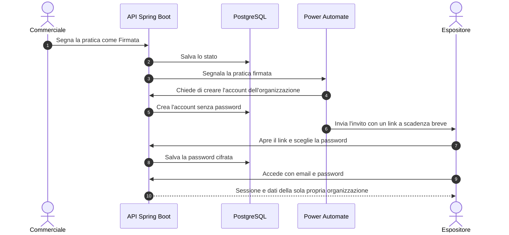

# Portale web · Requisiti del frontend

Documento di lavoro del team **Stand up** per ARCADE Milano 2026. Raccoglie come dovrebbe comportarsi il portale web in React per espositori, visitatori e staff, con le idee tratte da due portali fieristici pubblici. Sono proposte da validare con il gruppo e con il cliente: dove serve una scelta, la scelta è già indicata e si può cambiare con un parametro.

Torna al [README](../README.md) · [Blueprint digitale](blueprint-digitale.md)

## 1. Principi

1. **Un ruolo, un ingresso.** Ogni persona arriva subito alla schermata che le serve.
2. **Un solo dato per ogni informazione.** Edizione, date e sede arrivano dalla tabella Edizione del database, mai scritte a mano in più pagine.
3. **Privacy by design.** Si raccoglie il minimo e ciascuno vede solo il proprio ambito.
4. **Accessibilità.** Contrasto dei testi di almeno 4,5 a 1, link "Vai al contenuto", uso comodo da telefono.

## 2. Home del portale

| Elemento | Contenuto |
| --- | --- |
| Testata fissa | Logo, nome dell'edizione, date e sede dal database, cambio lingua italiano e inglese (facoltativo) e accesso |
| Due ingressi | "Vuoi visitare ARCADE Milano?" con il pulsante Registrati, e "Vuoi esporre?" con il pulsante Richiedi uno stand |
| Numeri chiave | Visitatori, espositori e stand dell'edizione precedente, letti dal database |
| Edizioni | Menu con 2024, 2025 e 2026 |

I due pulsanti hanno lo stesso peso visivo. **Richiedi uno stand** crea una pratica in stato Bozza per il commerciale, compilando il primo passaggio del flusso commerciale. **Registrati** raccoglie un contatto con consenso, e per i biglietti rimanda alla biglietteria esterna.

Campi minimi dei moduli:
- Visitatore: email e consenso, il nome è facoltativo.
- Espositore: azienda, referente, email, categoria, metri quadri desiderati e consenso.
- In entrambi i casi, un link alla informativa privacy del progetto.

## 3. Accesso per ruolo

| Utente | Come entra | Motivo |
| --- | --- | --- |
| Espositore | Email e password, con Spring Security e un token JWT a scadenza breve | Persona esterna, senza account Microsoft aziendale |
| Commerciale, Direzione, Amministratore, Staff interno | Account aziendale Microsoft (Entra ID), se disponibile | Utenti interni, con gruppi e ruoli già gestiti |
| Visitatore | Nessun accesso obbligatorio, basta il biglietto con QR | Meno dati personali da proteggere |

Gli espositori **non si registrano da soli**: l'account nasce dopo la firma del contratto, con un invito.

Regole di sicurezza:
- Password cifrate con BCrypt, mai salvate in chiaro.
- Blocco temporaneo dopo alcuni tentativi sbagliati.
- Sessione che scade dopo un periodo di inattività, con messaggio chiaro e ritorno al login.
- Link di invito e di recupero validi per poco tempo e utilizzabili una volta sola.
- Messaggio di errore generico: "email o password non corretti".
- Ogni account è legato a una sola organizzazione, e l'API filtra i dati su quella.
- Sotto il pulsante di accesso, un link all'informativa privacy, separato dai termini d'uso.

## 4. Area espositore dopo l'accesso

Dopo il login l'espositore trova subito una pagina utile, mai vuota.

| Blocco | Contenuto |
| --- | --- |
| Saluto e azienda | Nome dell'utente, azienda ed edizione, con il Logout sempre visibile |
| Il mio stand | Codice, padiglione, metri quadri e link alla planimetria |
| Il mio contratto | Stato della pratica (Bozza, Inviata, Firmata, Acconto ricevuto) e documenti da SharePoint |
| I miei contatti | Solo i lead raccolti allo stand dell'espositore |
| Riepilogo post-fiera | Presenze stimate nello stand e confronto con l'edizione precedente |
| Avvisi | Comunicazioni dell'organizzazione per gli espositori |

Se un blocco non ha dati, mostra un messaggio che spiega cosa manca e cosa fare.

## 5. Elenco espositori

- **Ricerca** per nome e **filtri per categoria con il conteggio** accanto, per esempio "Videogiochi indie (24)". I conteggi si calcolano con una query di raggruppamento.
- **Scheda espositore** con logo, descrizione, marchi, categorie, stand, documenti e prodotti.
- **In evidenza**: posizione in cima all'elenco, venduta come servizio nel listino e nel contratto. Si misura nel cruscotto come ricavo.
- **Contatti pubblici** (sito, email, telefono) visibili solo se l'espositore lo sceglie, con un campo "visibile nel portale".
- **Ricerca per interessi**: il visitatore sceglie 3 o 5 categorie e vede per primi gli espositori che le hanno. Le scelte restano nel browser, senza account e senza salvarle nel database.
- **Il mio giro**: i preferiti salvati nel browser del visitatore.
- Il conteggio aggregato delle categorie scelte diventa un indicatore, l'**interesse per categoria**, senza identificare nessuno.

## 6. Avvisi

Una tabella semplice di comunicazioni di servizio, come cambi di orario, varchi chiusi o novità sui padiglioni. Ogni avviso ha titolo, testo, pubblico (visitatori, espositori, staff) e data, e compare in alto nel portale per il pubblico a cui è destinato. Sostituisce un blog, che non fa parte del perimetro.

## 7. Cookie e consenso

- Si usano solo cookie tecnici finché possibile, e in quel caso il banner non serve ma va scritto nella documentazione privacy.
- Se serve un banner, le tre azioni (Impostazioni, Rifiuta tutto, Accetta tutto) hanno lo stesso peso visivo.
- Nessuna data di nascita raccolta: la fascia d'età arriva dal tipo di biglietto, per esempio minorenne o adulto.

## 8. Dati e API da aggiungere

| Elemento | Descrizione |
| --- | --- |
| `categoria`, `espositore_categoria` | Categorie e collegamento con gli espositori, per filtri e ricerca per interessi |
| `espositore.in_evidenza`, `espositore.visibile_portale` | Posizione in evidenza e scelta sui contatti pubblici |
| `avviso` | Titolo, testo, pubblico, data |
| `richiesta_espositore`, `richiesta_visitatore` | Richieste dalla home, che alimentano la pratica in Bozza |
| `GET /espositori?q=&categorie=` | Elenco con ricerca e filtri |
| `GET /espositori/categorie` | Categorie con i conteggi |
| `POST /richieste/espositore`, `POST /richieste/visitatore` | Moduli della home |
| `GET /avvisi?pubblico=` | Avvisi per pubblico |
| `POST /auth/login`, `POST /auth/invito/accetta`, `POST /auth/password/recupero` | Accesso degli espositori |

## 9. Cosa non prendiamo

- Blog e notizie di settore, fuori dal perimetro.
- Matchmaking tra visitatori ed espositori e agenda personale con account, per i dati personali e i tempi.
- Verifica dell'età con la domanda "hai più di 18 anni", che è solo una dichiarazione.
- Area stampa e accrediti: possibile sviluppo futuro, come profilo facoltativo.
- Grafica, immagini e testi dei siti di riferimento: il progetto usa la palette ufficiale di Stand up e immagini proprie o libere da diritti, con la fonte indicata.

## 10. Riferimenti

| Sito | Che cosa abbiamo preso |
| --- | --- |
| [Bar Convent Berlin](https://www.barconvent.com/berlin/en-gb.html) | Home con due ingressi, elenco espositori con filtri e conteggi, espositore in evidenza, preferiti, area riservata separata, badge digitale e gestione dei contatti allo stand |
| [Roma Bar Show, Media Room](https://romabarshow.com/media-room/) | Accredito passo per passo con pass QR, modulo con consenso privacy, archivio delle edizioni precedenti, link "Vai al contenuto" |

Errori visti nei siti di riferimento, da evitare: date di edizioni diverse nella stessa pagina, link privacy generici, contatti duplicati, file su servizi esterni e pagine vuote dopo l'accesso.

## 11. Effetto sul piano

Nessuna nuova attività nel Gantt. Il lavoro rientra in "Mockup back office, cruscotto e portale", "Privacy by design e modello di sicurezza", "Flusso commerciale semplificato" e "Portale espositori con riepilogo post-fiera".
