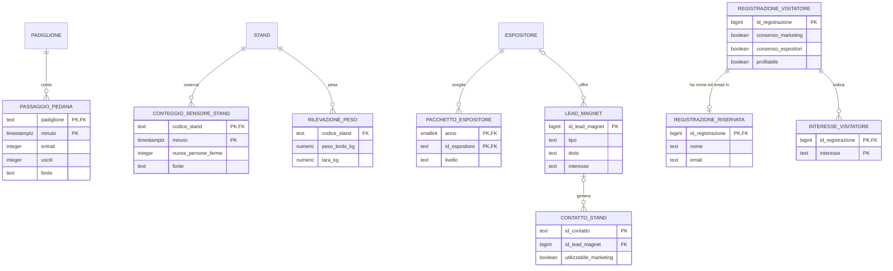
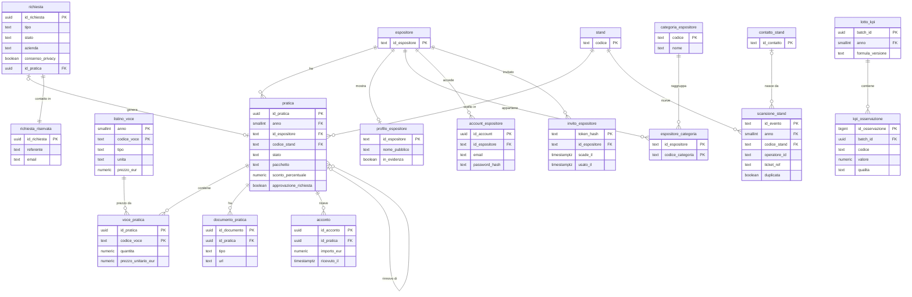
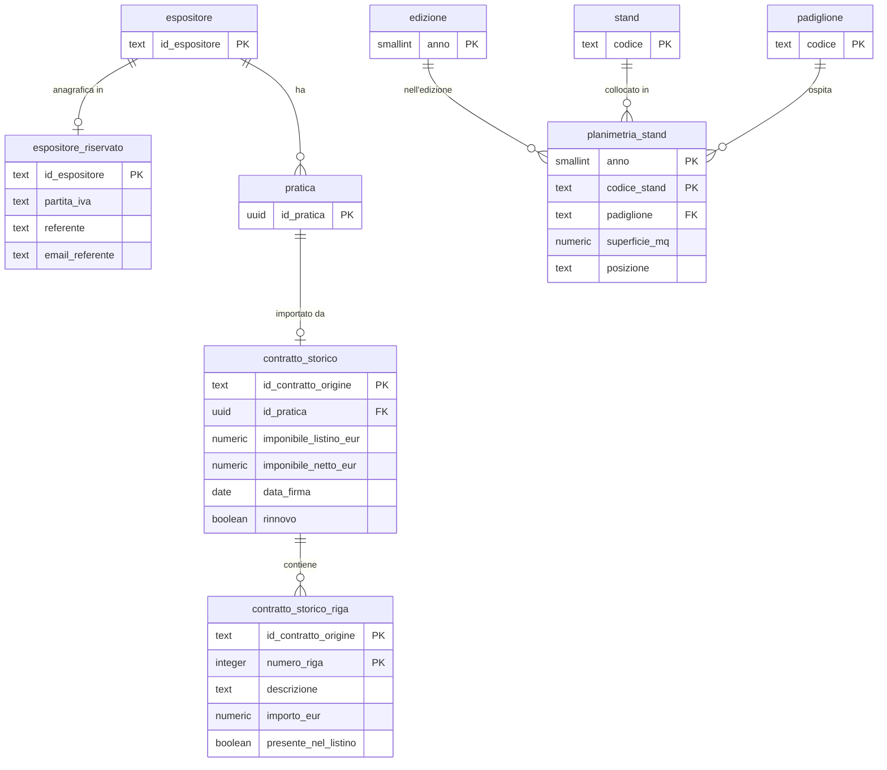
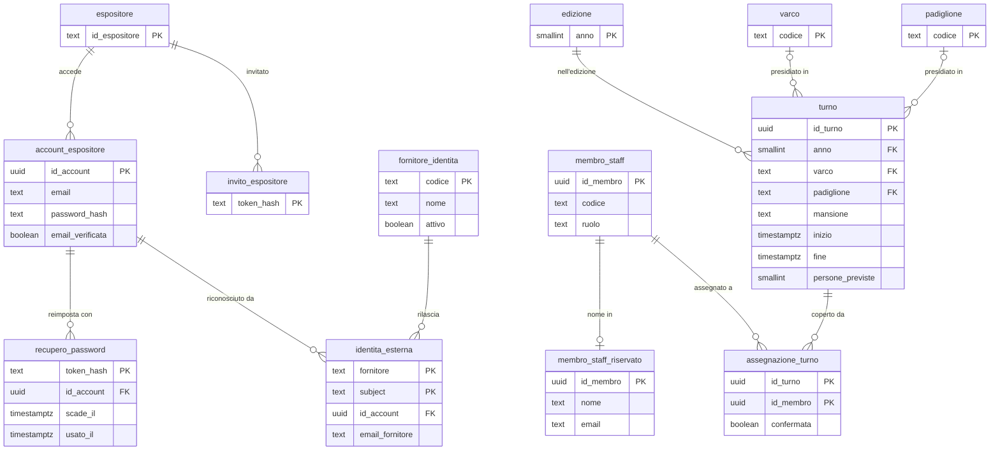

# Modello ER

Il diagramma descrive lo schema `arcade` di PostgreSQL così come lo costruiscono le [migrazioni](../database/migrations) da `V001` a `V026`. Se diagramma e SQL non coincidono, vale l'SQL. Il significato di ogni colonna è nel [dizionario dati](dizionario-dati.md).

## 1. Modello completo

Sono mostrate le chiavi e gli attributi principali. `PK` indica la chiave primaria e `FK` la chiave esterna. Per leggere meglio il disegno, i legami con `edizione` sono tracciati solo per `ordine` e `assegnazione_stand`, ma ogni tabella con la colonna `anno` ha una chiave esterna verso `edizione.anno`. Le tabelle di servizio dell'importazione sono elencate nel paragrafo 2.

```mermaid
erDiagram
    EDIZIONE ||--o| PARAMETRI_STIMA : "ha"
    EDIZIONE ||--o{ ORDINE : "contiene"
    EDIZIONE ||--o{ ASSEGNAZIONE_STAND : "assegna"

    CANALE_VENDITA ||--o{ ORDINE : "vende"
    ORDINE ||--|{ BIGLIETTO : "comprende"
    CATEGORIA_BIGLIETTO ||--o{ BIGLIETTO : "classifica"

    PADIGLIONE ||--o{ VARCO : "ospita"
    PADIGLIONE ||--o{ STAND : "ospita"
    PADIGLIONE ||--o{ PASSAGGIO_PEDANA : "conta"
    VARCO ||--o{ ACCESSO : "rileva"

    STAND ||--o{ ASSEGNAZIONE_STAND : "viene assegnato"
    ESPOSITORE ||--o{ ASSEGNAZIONE_STAND : "riceve"
    ESPOSITORE ||--o{ PACCHETTO_ESPOSITORE : "sceglie"
    ESPOSITORE |o--o{ LEAD_MAGNET : "offre"

    STAND ||--o{ VISITA_STAND_ORA : "misura"
    STAND ||--o{ CONTATTO_STAND : "raccoglie"
    ESPOSITORE ||--o{ CONTATTO_STAND : "riceve"
    LEAD_MAGNET |o--o{ CONTATTO_STAND : "genera"
    CONTATTO_STAND ||--o| CONTATTO_RISERVATO : "ha email in"

    STAND ||--o{ RILEVAZIONE_PESO : "pesa"
    STAND ||--o{ CONTEGGIO_SENSORE_STAND : "osserva"

    REGISTRAZIONE_VISITATORE ||--o| REGISTRAZIONE_RISERVATA : "ha nome ed email in"
    REGISTRAZIONE_VISITATORE ||--o{ INTERESSE_VISITATORE : "indica"

    EDIZIONE {
        smallint anno PK
        date inizio_vendite
        date inizio_fiera
        date fine_fiera
    }
    PARAMETRI_STIMA {
        smallint anno PK, FK
        numeric peso_medio_kg
        numeric soglia_rumore_kg
        numeric persone_per_mq
        numeric soglia_avviso
    }
    CANALE_VENDITA {
        text codice PK
        text descrizione
    }
    CATEGORIA_BIGLIETTO {
        text codice PK
        text descrizione
        smallint persone_incluse
    }
    ORDINE {
        text id_ordine PK
        smallint anno FK
        text canale FK
    }
    BIGLIETTO {
        text codice PK
        text id_ordine FK
        smallint anno FK
        text categoria FK
        date giorno_valido
        smallint quantita
        numeric importo_eur
    }
    PADIGLIONE {
        text codice PK
        numeric superficie_mq
        integer capienza
    }
    VARCO {
        text codice PK
        text padiglione FK
    }
    ACCESSO {
        text id_evento PK
        smallint anno FK
        text varco FK
        timestamptz letto_il
        text codice_biglietto
        text esito
        smallint persone
    }
    STAND {
        text codice PK
        text padiglione FK
        numeric superficie_mq
        smallint fila
        smallint colonna
    }
    ESPOSITORE {
        text id_espositore PK
        text ragione_sociale
    }
    ASSEGNAZIONE_STAND {
        smallint anno PK, FK
        text codice_stand PK, FK
        text id_espositore FK
    }
    PACCHETTO_ESPOSITORE {
        smallint anno PK, FK
        text id_espositore PK, FK
        text livello
    }
    VISITA_STAND_ORA {
        text id_riferimento PK
        smallint anno FK
        text codice_stand FK
        timestamptz ora_inizio
        integer scansioni
    }
    CONTATTO_STAND {
        text id_contatto PK
        smallint anno FK
        text codice_stand FK
        text id_espositore FK
        bigint id_lead_magnet FK
        text interesse
        boolean utilizzabile_marketing
    }
    CONTATTO_RISERVATO {
        text id_contatto PK, FK
        text email
    }
    LEAD_MAGNET {
        bigint id_lead_magnet PK
        smallint anno FK
        text id_espositore FK
        text tipo
        text titolo
        text interesse
        boolean attivo
    }
    RILEVAZIONE_PESO {
        bigint id PK
        smallint anno FK
        text codice_stand FK
        timestamptz rilevato_il
        numeric peso_lordo_kg
        numeric tara_kg
        text fonte
    }
    PASSAGGIO_PEDANA {
        text padiglione PK, FK
        timestamptz minuto PK
        smallint anno FK
        integer entrati
        integer usciti
        text fonte
    }
    CONTEGGIO_SENSORE_STAND {
        text codice_stand PK, FK
        timestamptz minuto PK
        smallint anno FK
        integer nuove_persone_ferme
        text fonte
    }
    REGISTRAZIONE_VISITATORE {
        bigint id_registrazione PK
        smallint anno FK
        text provincia
        text fascia_eta
        boolean consenso_marketing
        boolean consenso_espositori
        boolean profilabile
    }
    REGISTRAZIONE_RISERVATA {
        bigint id_registrazione PK, FK
        text nome
        text email
    }
    INTERESSE_VISITATORE {
        bigint id_registrazione PK, FK
        text interesse PK
    }
```

## 2. Come leggerlo

| Area | Tabelle | A cosa servono |
| --- | --- | --- |
| Riferimento | `edizione`, `padiglione`, `varco`, `stand`, `espositore`, `assegnazione_stand`, `categoria_biglietto`, `canale_vendita` | Anagrafiche comuni a tutte le edizioni. Un espositore occupa uno stand per edizione. |
| Biglietteria | `ordine`, `biglietto` | Ordini e biglietti, senza dati personali. Un biglietto può coprire più persone (`quantita`). |
| Accessi | `accesso` | Una riga per lettura al varco, con esito e numero di persone. |
| Stand e contatti | `visita_stand_ora`, `contatto_stand`, `contatto_riservato` | Scansioni per ora e contatti raccolti. L'email sta in una tabella separata. |
| Pacchetti e lead magnet | `pacchetto_espositore`, `lead_magnet` | BASE o PREMIUM per edizione, e ciò che il visitatore riceve in cambio del contatto. |
| Presenze | `passaggio_pedana`, `conteggio_sensore_stand`, `rilevazione_peso`, `parametri_stima` | Pedane nei padiglioni, sensori AI agli stand, stima dal peso e parametri di calcolo. |
| Visitatori registrati | `registrazione_visitatore`, `registrazione_riservata`, `interesse_visitatore` | Consensi separati e interessi. Nome ed email stanno in una tabella riservata. |
| Scansioni 2026 | `scansione_stand` | Una riga per scansione con operatore e biglietto pseudonimizzato. Le scansioni ripetute sono marcate `duplicata` e non contano. |
| Area commerciale | `listino_voce`, `pratica`, `voce_pratica`, `documento_pratica`, `acconto`, `richiesta`, `richiesta_riservata` | Dalla richiesta dal sito alla pratica firmata, con listino, sconti, documenti e acconti. Nome ed email del richiedente stanno in una tabella riservata. |
| Profilo e accesso | `profilo_espositore`, `categoria_espositore`, `espositore_categoria`, `account_espositore`, `invito_espositore`, `avviso` | Vetrina pubblica degli espositori, account con inviti monouso e avvisi di servizio. Password e token si conservano solo come impronta. |
| KPI da BAD | `lotto_kpi`, `kpi_osservazione` | Lotti di indicatori ricevuti dall'API, ripetibili grazie al `batch_id`. Nessun dato personale. |
| Servizio | `importazione`, `scarto_importazione`, `catalogo_anomalia`, `fascia_stand_mancante`, `dizionario_dati` | Tracciano i caricamenti, le righe scartate e le anomalie, e descrivono ogni colonna. |

## 3. Novità del SAL 1

La migrazione `V007` aggiunge pedane, sensori AI, pacchetti, registrazione del visitatore e lead magnet. Questo schema più piccolo mostra solo quelle tabelle e i loro legami.

| Novità | Tabelle | Indicatori che alimentano |
| --- | --- | --- |
| Pedane conta-persone | `passaggio_pedana` | Persone presenti, picco di presenza, saturazione e visitatori per m² |
| Sensori AI agli stand | `conteggio_sensore_stand` | Persone ferme allo stand e resa dello stand |
| Pacchetto dell'espositore | `pacchetto_espositore` | Accesso alla stima dal peso, riservato al PREMIUM |
| Lead magnet | `lead_magnet`, `contatto_stand.id_lead_magnet` | Contatti qualificati (MQL), quota MQL e resa dei lead magnet |
| Registrazione del visitatore | `registrazione_visitatore`, `registrazione_riservata`, `interesse_visitatore` | Interessi del pubblico, solo come totali e solo per chi è profilabile |

## 4. Novità dalla V008 alla V026

La `V008` corregge lo schema dopo il confronto con il contratto OpenAPI: sede e stato dell'edizione, nome del padiglione, stand non disponibili, motivo del rifiuto agli ingressi, costi dell'edizione, token di revoca dei consensi, peso senza letture doppie e la tabella `scansione_stand`. Aggiunge anche le viste `v_stand_stato`, `v_visitatori_riepilogo`, `v_costo_per_mql` e `v_visite_stand_scansioni`.

La `V009` costruisce l'area commerciale, l'accesso degli espositori e i KPI ricevuti da BAD. Il disegno mostra solo queste tabelle.

| Regola | Dove è garantita |
| --- | --- |
| Lo stato della pratica va solo avanti: BOZZA, INVIATA, FIRMATA, ACCONTO_RICEVUTO | Trigger `pratica_controlla` |
| Dopo la bozza la pratica ha uno stand | Vincolo di controllo su `pratica` |
| Lo sconto sopra la soglia (10 di partenza, in `parametri_stima`) richiede approvazione | Trigger `pratica_controlla`, colonna `approvazione_richiesta` |
| Alla firma lo stand viene assegnato e il pacchetto registrato, nella stessa transazione. Se lo stand è già assegnato o non disponibile la firma fallisce | Trigger `pratica_alla_firma` |
| Il prezzo applicato resta quello dell'offerta anche se il listino cambia | `voce_pratica.prezzo_unitario_eur` |
| Il ricavo per m² usa le pratiche firmate, al netto di IVA e sconti | Vista `v_ricavo_per_mq` |

### Dalla V010 alla V014: storico commerciale, idempotenza e consensi

La `V010` conserva dati commerciali storici, informazioni riservate degli espositori e planimetrie per edizione; consente inoltre di pianificare il 2026 senza inventare le date. La `V011` aggiunge le chiavi di idempotenza e i token monouso di recupero password e revoca consensi. La `V012` registra il consenso alla condivisione e il lead magnet della scansione. La `V013` permette di creare i metadati di un documento prima che sia configurato un archivio che fornisca un URL. La `V014` rende indipendente dal `search_path` della connessione il funzionamento dei trigger commerciali.

Tre tabelle di servizio non compaiono nei disegni perché non hanno legami interessanti: `acquisizione_evento` tiene gli identificativi degli eventi già ricevuti, così un invio ripetuto non viene contato due volte; `revoca_registrazione_visitatore` conserva l'impronta del token con cui il visitatore modifica o revoca i consensi; `dizionario_dati` è il dizionario stesso; `auth_login_rate_limit` conta i tentativi di accesso falliti e `audit_event` registra gli accessi ai dati personali.

### Dalla V015 alla V023: ruoli di esecuzione, registro accessi e proiezioni per BAD

La `V015` è il passo che rende vere le regole di visibilità: crea i ruoli con cui gira l'applicazione, `arcade_api`, `arcade_pubblico`, `arcade_scrittura_pubblica`, `arcade_registrazione`, `arcade_dispositivo` e `arcade_bad`, toglie al ruolo di sola lettura le tabelle dei visitatori e stringe la regola dei contatti: un espositore vede un contatto solo se è suo, se c'è il consenso a condividerlo, se è utilizzabile per il marketing, se la fascia d'età è adulta e, dal 2026, se c'è un lead magnet. Aggiunge anche `auth_login_rate_limit`, che conta i tentativi di accesso falliti, e `audit_event`, il registro degli accessi ai dati personali.

Dalla `V016` alla `V023` arrivano le proiezioni per BAD, che non espongono tabelle riservate, l'archivio dei documenti commerciali dentro il database e l'isolamento dei contratti storici per espositore.

### La V024 e la V025: turni del personale e accesso con Google o Microsoft

La `V024` aggiunge i turni del personale, che servono alla schermata Operatività evento, e allinea due cose lasciate aperte dalle migrazioni precedenti: il pacchetto `NON_DICHIARATO`, che faceva fallire la firma di una pratica importata, e i permessi mancanti sui token della `V011`. La `V026` completa i permessi di lettura sull'edizione.

La `V025` permette di entrare in tre modi, con un solo account: email e password, Google oppure Microsoft. Del fornitore esterno si conserva l'identificativo stabile e non l'email, perché l'email di una persona cambia mentre quell'identificativo no.

| Regola | Dove è garantita |
| --- | --- |
| Lo stato della pratica va solo avanti: BOZZA, INVIATA, FIRMATA, ACCONTO_RICEVUTO | Trigger `pratica_controlla` |
| Dopo la bozza la pratica ha uno stand | Vincolo di controllo su `pratica` |
| Lo sconto sopra la soglia richiede approvazione | Trigger `pratica_controlla`, colonna `approvazione_richiesta` |
| Alla firma lo stand viene assegnato e il pacchetto registrato, nella stessa transazione | Trigger `pratica_alla_firma` |
| Il prezzo applicato resta quello dell'offerta anche se il listino cambia | `voce_pratica.prezzo_unitario_eur` |
| Un'edizione senza date non può essere dichiarata attiva o conclusa | Vincolo `edizione_date_complete_se_confermata` |
| Un turno sta a un varco oppure in un padiglione, mai in entrambi e mai in nessuno | Vincolo `turno_un_solo_luogo` |
| La stessa persona non può stare su due turni sovrapposti | Vincolo di esclusione su `assegnazione_turno` |
| Se il turno viene spostato, gli orari delle assegnazioni lo seguono | Chiave esterna con `ON UPDATE CASCADE` |
| La stessa identità Google o Microsoft non può valere per due account | Chiave primaria di `identita_esterna` |
| Ogni colonna del database ha una descrizione nel dizionario | Controllo in fondo a ogni migrazione |

## 5. Dati personali e visibilità

- **Dati personali separati.** Email e nome non stanno mai nelle tabelle usate per i calcoli: `contatto_riservato` e `registrazione_riservata` sono tabelle a parte. `registrazione_riservata` è leggibile solo dal ruolo `arcade_dati_personali`.
- **Lo staff e i suoi turni non si vedono dal lato espositore.** `membro_staff`, `turno` e `assegnazione_turno` sono leggibili solo dai ruoli interni, i nomi solo da `arcade_dati_personali`.
- **Lo staff e i suoi turni non si vedono dal lato espositore.** `membro_staff`, `turno` e `assegnazione_turno` sono leggibili solo dai ruoli interni, i nomi solo da `arcade_dati_personali`. Lo stesso vale per i token di accesso e per l'anagrafica in `espositore_riservato`.
- **Account e listino restano fuori dalla lettura.** `account_espositore` e `invito_espositore` sono leggibili solo dal ruolo `arcade_autenticazione`, `richiesta_riservata` solo da `arcade_dati_personali`. Il listino, le richieste e i KPI non sono visibili agli espositori. `scansione_stand.operatore_id` e `ticket_ref` non sono leggibili dall'espositore.
- **Un espositore vede solo il proprio.** Con la row-level security, l'espositore legge il proprio pacchetto, i sensori AI del proprio stand e i lead magnet di ARCADE Milano e i propri. Non vede mai le registrazioni dei visitatori, le pedane o le viste aggregate della direzione.
- **La stima dal peso è solo PREMIUM.** La policy su `rilevazione_peso` lascia passare le righe solo se l'espositore ha il pacchetto PREMIUM per quell'edizione. Un espositore BASE non le vede nemmeno interrogando il database direttamente.
- **Nessuna profilazione dei minori.** Il modulo di registrazione offre solo fasce d'età da 18 anni in su, e `profilabile` è vero solo con il consenso marketing e una fascia adulta dichiarata.

## 6. Punti da conoscere

- `accesso.codice_biglietto` non ha una chiave esterna verso `biglietto`, perché 70 codici letti ai tornelli non esistono in biglietteria.
- Pedane, sensori AI e rilevazioni di peso hanno la colonna `fonte`, con valore `SIMULATA` o `SENSORE`, perché nella demo i dati sono simulati.
- Le viste dei KPI (per esempio `v_presenze_padiglione`, `v_picco_presenza_giorno`, `v_mql_stand`) leggono queste tabelle e non memorizzano dati. Sono definite nelle migrazioni dalla `V003` alla `V026`.
- Il diagramma più vecchio in [dati storici](dati-storici.md) descrive solo lo schema per le edizioni 2024 e 2025. Per il quadro completo vale questo documento.
